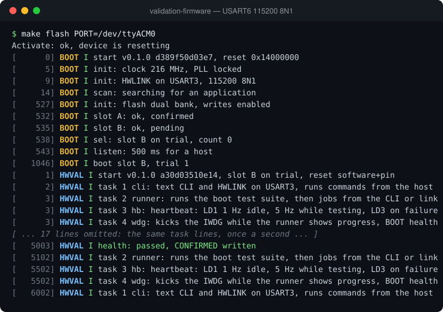

# validation-firmware

HWVAL is a FreeRTOS firmware that tests every usable hardware block of the NUCLEO-F767ZI board and its STM32F767ZI MCU. It is driven from a terminal over the ST-LINK virtual COM port, from a Python script for automated runs, or from the HWVAL Studio desktop GUI through the binary HWLINK link mode. Each test is traced to a requirement, results are reported as JSON and Markdown, and build gates check the memory footprint, requirement coverage and static analysis. Use it for board bring-up, design validation and as the end-of-line test image on the production line.

## Debug terminal

The debug log from a reset on a NUCLEO-F767ZI (USART6, 115200 8N1), recorded from the board. [Watch it replay line by line](https://soccentric-stm32.github.io/#validation) on the project page.



<details>
<summary>Plain text</summary>

```console
$ make flash PORT=/dev/ttyACM0
Activate: ok, device is resetting
[      0] BOOT I start v0.1.0 d389f50d03e7, reset 0x14000000
[      5] BOOT I init: clock 216 MHz, PLL locked
[      9] BOOT I init: HWLINK on USART3, 115200 8N1
[     14] BOOT I scan: searching for an application
[    527] BOOT I init: flash dual bank, writes enabled
[    532] BOOT I slot A: ok, confirmed
[    535] BOOT I slot B: ok, pending
[    538] BOOT I sel: slot B on trial, count 0
[    543] BOOT I listen: 500 ms for a host
[   1046] BOOT I boot slot B, trial 1
[      1] HWVAL I start v0.1.0 a30d03510e14, slot B on trial, reset software+pin
[      2] HWVAL I task 1 cli: text CLI and HWLINK on USART3, runs commands from the host
[      3] HWVAL I task 2 runner: runs the boot test suite, then jobs from the CLI or link
[      3] HWVAL I task 3 hb: heartbeat: LD1 1 Hz idle, 5 Hz while testing, LD3 on failure
[      3] HWVAL I task 4 wdg: kicks the IWDG while the runner shows progress, BOOT health
[ ... 17 lines omitted: the same task lines, once a second ... ]
[   5003] HWVAL I health: passed, CONFIRMED written
[   5102] HWVAL I task 2 runner: runs the boot test suite, then jobs from the CLI or link
[   5502] HWVAL I task 3 hb: heartbeat: LD1 1 Hz idle, 5 Hz while testing, LD3 on failure
[   5502] HWVAL I task 4 wdg: kicks the IWDG while the runner shows progress, BOOT health
[   6002] HWVAL I task 1 cli: text CLI and HWLINK on USART3, runs commands from the host
```

</details>

## Features

- Tests every usable peripheral of the STM32F767ZI and the NUCLEO board
- 196 test cases grouped by hardware block
- Test levels: standalone, harness-wired and external equipment
- Interactive text console over the ST-LINK virtual COM port
- Script mode with JSON output for automation
- HWLINK link mode (COBS + FlatBuffers) for HWVAL Studio and HWVAL Factory
- Operator prompts for tests that need a human action
- Destructive flash tests confined to a reserved sector
- Ethernet tests with ping, TCP/UDP echo and throughput (LwIP)
- USB CDC echo, SWO and watchdog halt checks
- Boot banner with version, commit, build date and reset cause
- `hwtest.py` host tool that writes JSON and Markdown reports per board
- Footprint gate for image size and free RAM
- Coverage gate: every requirement has a test and every peripheral is listed
- Strict cppcheck and `-Wall -Wextra -Werror`
- Generated test catalogue and a full user guide
- Measured board reference in [`docs/Hardware.md`](docs/Hardware.md)
- Reproducible Docker build environment

## Build and run

```bash
scripts/build.sh                             # build inside the stm32-dev container
scripts/docker-dev.sh flash build/hwval.elf  # flash over SWD
scripts/docker-dev.sh serial                 # open the console at 115200 8N1
python3 scripts/hwtest.py                    # run tests and write a report
```

## Documentation

| Document | Contents |
|---|---|
| [docs/SRS.md](docs/SRS.md) | Software requirements specification (SRS-HWVAL-F767) |
| [docs/Hardware.md](docs/Hardware.md) | Measured NUCLEO-F767ZI board reference |
| [docs/TEST_CATALOGUE.md](docs/TEST_CATALOGUE.md) | Generated catalogue of every test case |
| [docker/README.md](docker/README.md) | Build container, flashing and debugging |

## Project layout

```
board/            Board support: pin map, HAL/FreeRTOS/LwIP config, LwIP arch port
src/app/          Entry point, CLI, test framework, settings, version, boot contract
src/bsp/          Clock, UART, watchdog, MPU/cache, flash and syscall drivers
src/services/     Fault handling, FreeRTOS glue and the LwIP wrapper
src/protocol/     HWLINK framing, GUI link mode and flatcc arena hooks
src/generated/    Committed flatcc headers generated from protocol/hwlink.fbs
tests/            On-target test cases, one file per hardware block
protocol/         HWLINK FlatBuffers schema (single source of truth)
ld/               Linker scripts (flash sectors, section placement)
scripts/          Build, flash, host test and gate scripts
ci/               Release and packaging helpers used by the Jenkinsfile
docker/           Reproducible STM32 build/flash/debug container
docs/             SRS, board reference and generated test catalogue
third_party/      Vendored dependencies (flatcc)
```

## Related projects

- [bootloader](https://github.com/soccentric-stm32/bootloader) — A/B bootloader with UART update, CRC32 checks, trial boot and rollback
- [app-c-freertos](https://github.com/soccentric-stm32/app-c-freertos) — Demo application in C on FreeRTOS
- [app-c-zephyr](https://github.com/soccentric-stm32/app-c-zephyr) — Demo application in C on Zephyr RTOS
- [app-rust-freertos](https://github.com/soccentric-stm32/app-rust-freertos) — Demo application in Rust on Embassy
- [app-rust-zephyr](https://github.com/soccentric-stm32/app-rust-zephyr) — Demo application in Rust on Zephyr RTOS
- [validation-gui](https://github.com/soccentric-stm32/validation-gui) — HWVAL Studio: desktop GUI for tests, updates and flashing
- [factory-station](https://github.com/soccentric-stm32/factory-station) — HWVAL Factory: end-of-line test and provisioning station
- [soccentric-stm32.github.io](https://github.com/soccentric-stm32/soccentric-stm32.github.io) — Project website

## License

Released under the [MIT License](LICENSE) © 2026 Sandesh Ghimire. You are free
to use, modify and ship it in your own products.

Contributions are welcome. Fork the repository, make your change on a branch and
open a pull request. Bug reports, ideas and improvements are all appreciated.
